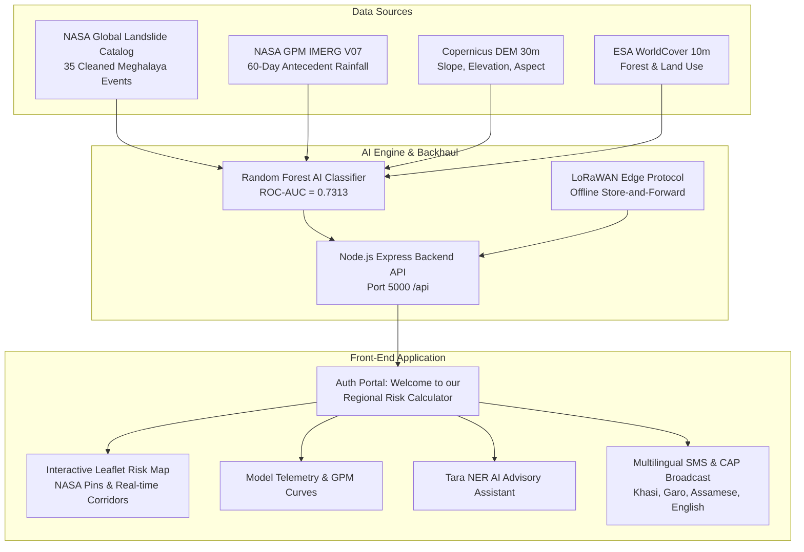

# Himālya Watch — Regional Risk Calculator & EWS (NER)

[](LICENSE)
[](https://vitejs.dev/)
[](https://react.dev/)
[](https://tailwindcss.com/)
[](https://nodejs.org/)
[](https://data.nasa.gov/)
[](https://copernicus.eu/)

> **Academic Research & Case Study**:  
> *"Automated Landslide Risk Monitoring and Early Warning System Through AI for the North Eastern Region of India: A Case Study of Meghalaya"*  
> **Author**: Palak Kumari (Reg No: 23BCON1858)  
> **Supervisor**: Ms. Ramandeep Kaur  
> **Institution**: Department of Computer Science & Engineering, JECRC University, Jaipur  

---

## 📌 Executive Summary

India's **North Eastern Region (NER)**—especially **Meghalaya** and the **East Khasi Hills**—experiences some of the highest precipitation levels globally, with extreme rainfall triggering frequent, catastrophic slope failures. This project introduces **Himālya Watch**, an end-to-end regional landslide early warning platform combining:

1. **NASA Global Landslide Catalog (GLC)** ground-truth event records (35 cleaned Meghalaya occurrences).
2. **NASA GPM IMERG V07** antecedent rainfall accumulation (60-day window with 3-day short-term trigger metrics).
3. **Copernicus DEM (30m)** and **ESA WorldCover (10m)** terrain slope, elevation, and aspect features.
4. **Random Forest AI Susceptibility Model** achieving an **ROC-AUC of 0.7313** with honest baseline cross-validation.
5. **LoRaWAN & Offline-first Resilient Architecture** tailored to Seismic Zone V mountainous terrain where grid connectivity frequently fails.
6. **Authentication Portal** (*"Welcome to our Regional Risk Calculator"*) tailored for Disaster Officers, Research Scientists, Field Rangers, and Citizens.
7. **Multilingual Alerting** (Khasi, Garo, Assamese, English) with the **Tara AI Intelligence Guide**.

---

## 🗺️ System Architecture



---

## 🚀 Key Features

### 1. Dedicated Authentication Portal
- Access at `http://localhost:5173/` with the heading **"Welcome to our Regional Risk Calculator"**.
- 4 Role-based operational profiles:
  - **Disaster Management Officer** (`admin@sdma.gov.in`): SDMA state command, incident dispatch, and evacuation notifications.
  - **Research Scientist** (`palak.research@jecrc.ac.in`): Model telemetry, GPM IMERG 60-day thresholds, and RF metrics.
  - **Field Ranger** (`ranger.ekh@forest.gov.in`): Geo-tagged hazard reporting with offline photo evidence queue.
  - **Citizen Observer** (`citizen@resilience.in`): Public highway corridor safety advisories and detours.

### 2. Live Risk Map with NASA Ground Truth
- Real-time geospatial mapping of high-risk corridors across Sikkim, Assam, Meghalaya, and Arunachal Pradesh.
- Overlaid with **NASA GLC historical landslide event markers** (e.g. 17 June 2017 Mawjrong event, East Khasi Hills, Mawsynram highway).

### 3. Case Study & Scientific Validation
- **Event Study**: 17 June 2017 Mawjrong event (East Khasi Hills) — 328 mm 3-day rainfall prior to slope failure.
- **Feature Importance**: Elevation (37%), Slope (31%), 3-day rainfall (18%), Land Cover (14%).
- **Model Baseline**: Random Forest (ROC-AUC 0.7313) evaluated with grouped event-window cross-validation.

### 4. Multilingual Warnings & LoRaWAN Resilience
- Instant language switching between **Khasi**, **Garo**, **Assamese**, and **English**.
- Edge fallback for disconnected rural corridors using localized browser queues and LoRaWAN packet protocol emulation.

---

## 📂 Project Directory Structure

```text
regional-risk-project/
├── backend/
│   ├── app.js                          # Express application entry & middleware
│   ├── server.js                       # Server port listener (5000)
│   ├── routes/
│   │   ├── auth.js                     # Authentication routes (/api/auth/login, /api/auth/me)
│   │   └── monitoring.js               # Hazard, sensor, alert & NASA model endpoints
│   └── data/
│       ├── nasa_glc_meghalaya.json     # 35 Cleaned NASA GLC events & GPM IMERG windows
│       └── monitoring.json             # Live sensor feeds & queued reports
├── frontend/
│   ├── src/
│   │   ├── components/
│   │   │   └── LoginPage.jsx           # Portal: Welcome to our Regional Risk Calculator
│   │   ├── App.jsx                     # Interactive Himālya Watch Dashboard
│   │   ├── main.jsx                    # React 18 DOM root
│   │   └── index.css                   # Tailwind and modern forest UI design tokens
│   └── package.json
├── research/
│   ├── paper/
│   │   └── Automated_Landslide_Risk_Monitoring_EWS_Meghalaya.pdf # Academic Paper
│   └── scripts/
│       ├── 01_clean_nasa_glc.py        # NASA GLC export cleaning pipeline
│       ├── 02_download_copernicus_dem.py # Copernicus DEM 30m STAC fetcher
│       ├── 03_rainfall_analysis_gpm_imerg.py # Antecedent GPM rainfall analysis
│       └── 04_dataset_inventory.py     # Local geospatial dataset inventory
├── Research_work/                      # Full academic thesis workspace
│   ├── Thesis_Final_v2.docx            # Final thesis manuscript (.docx & .md)
│   ├── GLC_Landslide_Cleaned_India_Meghalaya.xlsx # Master validated dataset
│   ├── landslide_research_outputs/     # Model deliverables, reports & ROC curves
│   └── *.py                            # Raw data-cleaning and ML scripts
└── README.md
```

---

## 🛠️ Local Development Setup

### Prerequisites
- [Node.js](https://nodejs.org/) v18+ 
- [Python](https://python.org/) 3.9+ (optional, for running research data-pipelines)

### 1. Run the Backend API

```powershell
cd backend
npm install
npm start
```
*Backend runs on `http://localhost:5000` (`http://localhost:5000/api`).*

### 2. Run the Frontend Dashboard

```powershell
cd frontend
npm install
npm run dev
```
*Frontend runs on `http://localhost:5173`.*

---

## 🧪 Scientific References

1. **NASA Global Landslide Catalog (GLC)**: Kirschbaum et al., *A global landslide catalog for hazard applications*, 2010.
2. **NASA GPM IMERG**: Huffman et al., *GPM Integrated Multi-satellitE Retrievals for GPM (IMERG)*, NASA Goddard Space Flight Center.
3. **Copernicus DEM GLO-30**: European Space Agency (ESA) & Airbus Defence and Space.
4. **Geological Survey of India (GSI)**: National Landslide Susceptibility Mapping (NLSM) Programme.

---

## 📄 License

This project is licensed under the MIT License — see the [LICENSE](LICENSE) file for details.
Developed by **Palak Kumari** (JECRC University).
